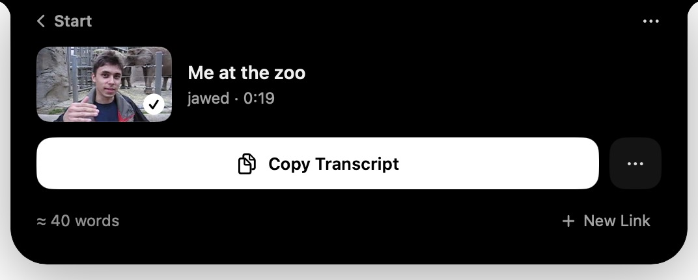

<div align="center">

# MindExtract

**Download and transcribe video from anywhere, right from your Mac's notch.**

[](https://github.com/dragon6sic6/MindExtract/releases/latest)
[](https://github.com/dragon6sic6/MindExtract/actions/workflows/tests.yml)

[](LICENSE)



</div>

Paste a link, or drag a file onto the notch, and MindExtract saves the video or turns the speech into text. The transcript is copied for you, with its title, link and channel on top, ready to paste into Claude, ChatGPT or anywhere else. Speech recognition runs on your Mac. Nothing is uploaded.

## Features

- **Lives in the notch.** Hover over the notch, click it, or press ⌃⌥Space (you can change it) from any app. No Dock icon, no windows.
- **Link in, text out.** YouTube and over a thousand other sites, through [yt-dlp](https://github.com/yt-dlp/yt-dlp). A link you've copied is already waiting in the notch: one click transcribes it.
- **Any video or audio file.** Drag it onto the notch.
- **Ready for AI chats.** The finished transcript is on your clipboard. Copy it with or without timestamps; when several people speak, each turn says who.
- **About 40 languages, recognized automatically** for the 25 European ones.
- **Save the video** in the quality you choose, or only the audio.

## How it works

| Step | What does it | Where |
|------|--------------|-------|
| Fetching | [yt-dlp](https://github.com/yt-dlp/yt-dlp), bundled | Your Mac, talking to the video site |
| Reading the audio | AVFoundation, with a bundled ffmpeg for webm and mkv | Your Mac |
| Speech to text, 25 European languages | [NVIDIA Parakeet TDT 0.6B v3](https://huggingface.co/nvidia/parakeet-tdt-0.6b-v3) on Core ML, through [FluidAudio](https://github.com/FluidInference/FluidAudio) | Your Mac |
| Speech to text, Japanese, Chinese, Korean, Hindi and others | Apple's SpeechAnalyzer, built into macOS | Your Mac |
| Who said what | [pyannote community-1](https://huggingface.co/pyannote/speaker-diarization-community-1) through FluidAudio | Your Mac |

The speech model (630 MB) downloads once, on first launch, from a pinned revision; every file is checked against its SHA-256. A 4 minute video transcribes in a few seconds on Apple Silicon.

## Install

1. Download the latest `.dmg` from [Releases](https://github.com/dragon6sic6/MindExtract/releases/latest).
2. Drag **MindExtract** to **Applications** and open it.
3. The notch introduces itself and downloads the speech model.

Requires macOS 26 or later, on Apple Silicon or Intel. Signed and notarized by Apple; updates arrive through [Sparkle](https://sparkle-project.org).

To remove it and everything it stores (your saved videos and transcripts stay):

```bash
curl -fsSL https://raw.githubusercontent.com/dragon6sic6/MindExtract/master/scripts/uninstall.sh | bash
```

## Build from source

Requirements: Xcode 26 or later.

```bash
git clone https://github.com/dragon6sic6/MindExtract.git
cd MindExtract
scripts/setup-tools.sh        # fetches yt-dlp and builds ffmpeg into MindExtract/Resources
open MindExtract.xcodeproj
```

Build and run the **MindExtract** scheme. Run the tests with ⌘U, or:

```bash
xcodebuild test -project MindExtract.xcodeproj -scheme MindExtract -destination 'platform=macOS'
```

## Project layout

```
MindExtract/
  MindExtractApp.swift        App entry, launch, quit, Sparkle
  NotchController.swift       The panel over the notch: hover, click, drag, keyboard
  NotchModel.swift            What the notch is doing, from link to transcript
  NotchView.swift             Everything you see in the notch
  OnboardingView.swift        The introduction on first launch
  SettingsView.swift          Settings, in the notch's style
  TranscriptionManager.swift  One transcription job: audio, engine, speakers, file
  ParakeetEngine.swift        The speech model: pinned download, Core ML runtime, speakers
  YTDLPWrapper.swift          Looking up links and downloading with yt-dlp
  AudioConverter.swift        Any media to 16 kHz mono WAV
  AppServices.swift           Global shortcut, open at login
  Models.swift                Settings, history, shared types
  Resources/                  Bundled tools (see Resources/BUNDLING_BINARIES.md)
MindExtractTests/             Unit tests
scripts/                      Tools setup, release, DMG, uninstall
release/                      Release notes, DMG readme, signing entitlements
docs/                         Sparkle appcast (GitHub Pages)
```

## Releasing

1. Bump `MARKETING_VERSION` and `CURRENT_PROJECT_VERSION` in the project, and the same in `MindExtract/Info.plist`.
2. Write `release/notes.html` and add the version to [CHANGELOG.md](CHANGELOG.md).
3. From `master`, run `scripts/release.sh`. It builds a universal app, signs and notarizes it, makes the DMG and commits `docs/appcast.xml`.
4. Create the GitHub release `vX.Y.Z` and upload `dist/MindExtract-X.Y.Z-Universal.dmg`.
5. Check that the DMG downloads, then push. Sparkle offers the update once the appcast is live.

Notarization needs a Developer ID certificate and an app-specific password in the Keychain (see the top of `scripts/release.sh`).

## Credits

MindExtract builds on [yt-dlp](https://github.com/yt-dlp/yt-dlp) (Unlicense), [FFmpeg](https://ffmpeg.org) (LGPL 2.1+), [FluidAudio](https://github.com/FluidInference/FluidAudio) (Apache 2.0), [NVIDIA Parakeet TDT 0.6B v3](https://huggingface.co/nvidia/parakeet-tdt-0.6b-v3) (CC BY 4.0), [pyannote speaker-diarization-community-1](https://huggingface.co/pyannote/speaker-diarization-community-1) (CC BY 4.0) and [Sparkle](https://sparkle-project.org) (MIT).

Download and transcribe only content you have the right to use.

## License

[MIT](LICENSE) © 2026 [Mindact Solutions AB](https://mindact.ai)
